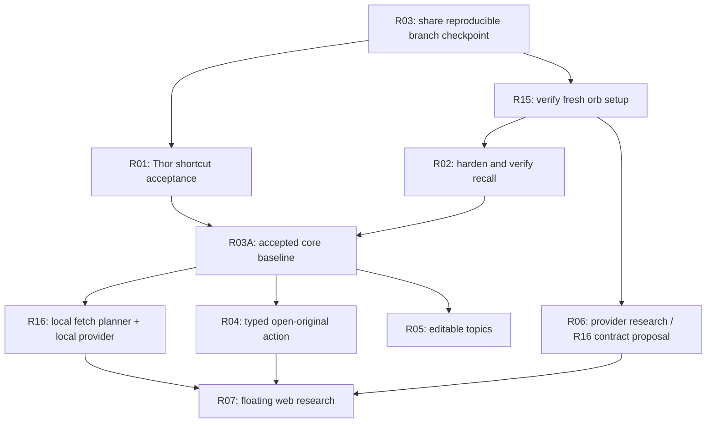

# How to continue Shade Menu

The central direction is now **the local model controls fetching**. The current recall implementation provides a first source and retrieval layer; a bounded local planner is the next architectural layer. See [the planner proposal](local-fetch-planner.md) and [orb setup/task briefs](orb-plan.md).

## Dependency order

R02's portable checks can run before R01, but final native signoff needs both. R16 contract research is independent; runtime integration waits for the accepted core. R08–R14 remain later or conditional in the [full roadmap](roadmap.md); the diagram is the immediate path, not a replacement backlog.

## Working loop

Open the [interactive continuation diagram](diagrams/continuation.html) locally after downloading/cloning the repo; GitHub displays the HTML source. The [editable diagram specification](diagrams/continuation.workflow.json) is versioned alongside it. The diagram shows the delivery loop, not a claim that orbs or providers have already been configured. The HTML currently needs vertical scrolling on smaller desktop sizes; [diagram evidence and limits](diagrams/README.md) record this. The Mermaid dependency diagram above is the primary compact view.

Repo brief → bounded orb branch → tests/evidence → integrator diff review → Thor native acceptance when relevant → integrate and update the shared brain. Independent research supplies evidence to review; it does not block unrelated bug fixes. Simple documentation changes do not require desktop acceptance.

## Immediate handoff

1. Configure the Amp project to start from `feat/work-recall` and use Push to Branch. Validate the first environment before launching parallel work.
2. Give the build orb the R02 regression brief and the research orb the R06/R16 design brief. Keep code ownership separate.
3. On Thor, resolve physical Alt+Space delivery and test the installed flow. The direct toggle already passed; synthetic Alt+Space failed. Do not repeat blind shortcut attempts or confuse orbital UI checks with this unresolved host behavior.
4. Review and integrate hardening, then implement the local planner against the existing recall provider. Evaluate an actual local generation model; embeddings alone do not plan fetches.
5. Add typed opening and configurable topics as bounded changes. Implement the web research view only when the planner/provider contracts and supported online access are ready.

## Publication is not release acceptance

Jordan explicitly requested pushing all project work on 2026-11-07. Publish the reviewed implementation and context as a feature-branch checkpoint now so other workers can continue. This supersedes the earlier plan to wait for full native acceptance before any implementation commit. R01/R02 remain open; sharing a branch does not approve a daily-driver release or replace master.
