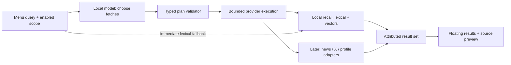

# Local model controls fetching

Status: Jordan's product direction, recorded 2026-11-07; planner design below is proposed, not implemented. Current code uses embeddings to rank explicitly configured local documents. Embedding retrieval is not a model choosing tools or providers.

## Product shape

The local model decides what information to fetch. The menu is the fast interface for inspecting and using it. For “Music,” fetch relevant prior work and ideas. For “latest on Elon Musk,” an enabled online scope could request recent news, X posts, and profile facts. The user should not need to manually compose several searches.

Use a local model to produce a small typed plan. Deterministic code validates it and invokes registered providers. A provider returns attributable results, not instructions for the next fetch. The model never supplies shell commands, credentials, arbitrary local paths, or arbitrary URLs to execute.

## Proposed contract

- Input: query, generation ID, user-enabled source scope, available provider IDs/capabilities, bounded time/result budget. Do not send the personal corpus just to decide which provider to call.
- Output: a versioned `FetchPlan` containing a bounded list of requests. Each request names a registered provider, query, optional freshness range/entity hint, and desired result count. An optional brief reason can explain a selection; it is not model chain-of-thought.
- Validation: reject unknown providers, disallowed scope, oversized queries, excessive fan-out, invalid time ranges, or unsupported operations. Clamp permitted budgets. A plan cannot enable a provider or grant access.
- Execution: run only validated requests, publish partial results, deduplicate canonical identities, cancel/ignore stale generations, and preserve the selection/preview. Provider errors remain distinguishable from zero results.
- Evidence: retain source IDs/URLs/paths and published/retrieved timestamps. Do not treat a model statement as a fetched fact. Entity hints must not silently combine different people.
- Fallback: lexical local recall remains available when the planner is missing, slow, malformed, or wrong. Do not hold the first useful local results until generation finishes.

Existing configured permissions define the source scope. The first implementation remains local-only; enabling a future web provider permits queries within that scope without an approval prompt for every routine search. Local source text is not automatically forwarded to online providers. Saving fetched web content into personal recall is a separate explicit action.

## Implementation order — R16

1. Define the provider capability/result contract and plan schema with deterministic fixture plans. Keep this independent of a particular model SDK.
2. Wrap existing recall as the first local provider. Preserve direct lexical search and `--no-exec` behavior.
3. Evaluate an actually available local **generation/tool-selection** model against routing cases. The currently configured embedding model is not evidence of that capability. Record model identity, latency, valid-plan rate, and retrieval outcomes before choosing it.
4. Add the local planner adapter, bounded execution, cancellation, and visible fallback. Test unsupported providers, adversarial source text, malformed output, outage, and rapid query changes.
5. Add web/news/X/profile adapters only after R06 establishes supported access. Integrate the floating research flow in R07 after R04 and R16.

Open decisions: exact generation model/API, schema field names, latency budget, maximum fan-out, and entity-resolution provider. The research orb proposes these with evidence; the build orb implements a reviewed bounded slice. A local-model loop that recursively fetches without a budget is outside this plan.
