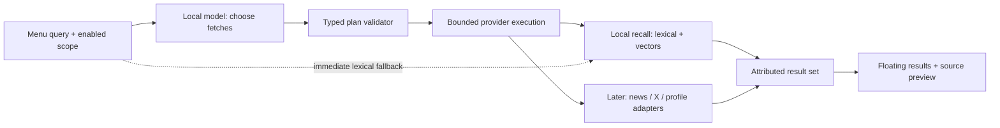

# Local model controls fetching

Status: opt-in local prototype implemented 2026-11-07. Jordan authorized proceeding with the first query-to-fetch slice; this does not close R03A native acceptance. The planner chooses a local recall query; embeddings remain a separate optional ranking layer. Broader multi-provider planning below remains proposed.

## Product shape

The local model decides what information to fetch. The menu is the fast interface for inspecting and using it. For “Music,” fetch relevant prior work and ideas. For “latest on Elon Musk,” an enabled online scope could request recent news, X posts, and profile facts. The user should not need to manually compose several searches.

Use a local model to produce a small typed plan. Deterministic code validates it and invokes registered providers. A provider returns attributable results, not instructions for the next fetch. The model never supplies shell commands, credentials, arbitrary local paths, or arbitrary URLs to execute.



## Proposed contract

- Input: query, generation ID, user-enabled source scope, available provider IDs/capabilities, bounded time/result budget. Do not send the personal corpus just to decide which provider to call.
- Output: a versioned `FetchPlan` containing a bounded list of requests. Each request names a registered provider, query, optional freshness range/entity hint, and desired result count. An optional brief reason can explain a selection; it is not model chain-of-thought.
- Validation: reject unknown providers, disallowed scope, oversized queries, excessive fan-out, invalid time ranges, or unsupported operations. Clamp permitted budgets. A plan cannot enable a provider or grant access.
- Execution: run only validated requests, publish partial results, deduplicate canonical identities, cancel/ignore stale generations, and preserve the selection/preview. Provider errors remain distinguishable from zero results.
- Evidence: retain source IDs/URLs/paths and published/retrieved timestamps. Do not treat a model statement as a fetched fact. Entity hints must not silently combine different people.
- Fallback: lexical local recall remains available when the planner is missing, slow, malformed, or wrong. Do not hold the first useful local results until generation finishes.

Existing configured permissions define the source scope. The first implementation remains local-only; enabling a future web provider permits queries within that scope without an approval prompt for every routine search. Local source text is not automatically forwarded to online providers. Saving fetched web content into personal recall is a separate explicit action.

## Implementation order — R16

1. Define the provider capability/result contract and plan schema with deterministic fixture plans. Keep this independent of a particular model SDK.
2. Wrap existing recall as the first local provider. Preserve direct lexical search and `--no-exec` behavior.
3. Evaluate an actually available local **generation/tool-selection** model against routing cases. The currently configured embedding model is not evidence of that capability. Record model identity, latency, valid-plan rate, and retrieval outcomes before choosing it.
4. Add the local planner adapter, bounded execution, cancellation, and visible fallback. Test unsupported providers, adversarial source text, malformed output, outage, and rapid query changes.
5. Add web/news/X/profile adapters only after R06 establishes supported access. Integrate the floating research flow in R07 after R04 and R16.

Open decisions: exact generation model/API, schema field names, latency budget, maximum fan-out, and entity-resolution provider. The research orb proposes these with evidence; the build orb implements a reviewed bounded slice. A local-model loop that recursively fetches without a budget is outside this plan.

## Implemented first slice

`src/fetch.rs` accepts a strict version-1 plan with exactly one request:

```json
{"version":1,"requests":[{"provider":"local_recall","query":"music","limit":10}]}
```

Unknown fields/providers, blank or control-containing queries, queries over 256 bytes, and limits outside 1–20 are rejected. No command, URL, path, freshness, or entity fields are accepted in this first schema. The provider wraps the existing local retrieval function. Returned records retain their original source attribution.

Opt in with a separate `planner` object in recall configuration: `enabled`, loopback `endpoint`, and generation `model`. Its shape matches `ollama`, but `ollama` continues to configure embeddings. No generation model is chosen or downloaded automatically. With no enabled planner, existing recall behavior is unchanged.

The adapter uses [Ollama /api/generate](https://docs.ollama.com/api/generate), nonstreaming JSON output, temperature zero, and at most 160 generated tokens. Transport reuses the loopback-only HTTP helper, with a five-second response deadline and 64 KiB response ceiling. The query and fixed provider contract are sent; original source documents are not in the planner prompt. Native UI publishes lexical results before planning; late generations are ignored by the existing UI generation checks. CLI `--work-search` uses the same planner/provider path.

Malformed, offline, incomplete, or timed-out planning falls back to lexical search of the **original** query, with a visible reason. A rewritten query with no results also falls back. Successful planning may take up to five seconds plus the existing optional semantic request budget; cancellation currently discards stale replies rather than interrupting in-flight TCP work. Incorrect rewrites that return plausible but irrelevant results still need quality evaluation. The local-generation model evaluation and installed native acceptance remain separate checks.

Two live warm/cold attempts with the resident generation model exceeded the initial two-second deadline and correctly fell back to lexical Music results. The prototype deadline was raised to five seconds for evaluation while preserving immediate native lexical results. This is not evidence of a completed model selection or a proven latency target.

### Live evaluation on Thor — 2026-11-07

Used the already resident `qwen3-coder-next:48k` via temporary configuration, keeping the installed menu configuration unchanged. Two attempts at a two-second planner deadline timed out and returned original-query lexical results. With the five-second bound, `music` completed through the local planner and hybrid recall, returning Music player and Music scenes and playlists first. This is one successful real-corpus query, not a routing-quality or latency benchmark. The optional embedding step has its separate deadline. No model was downloaded.
